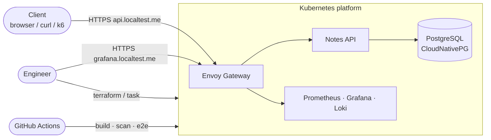
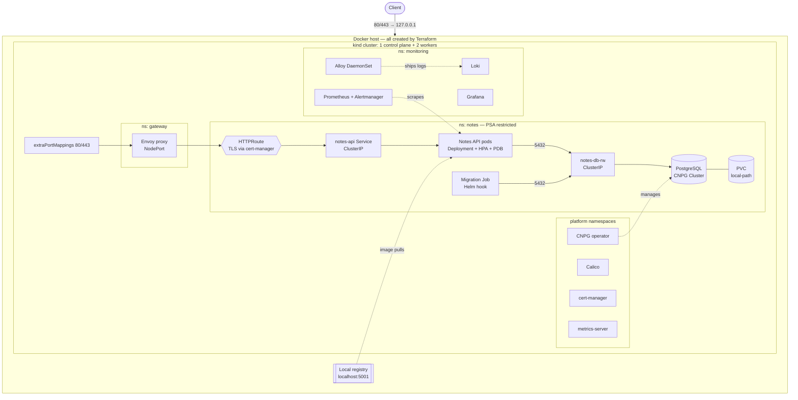
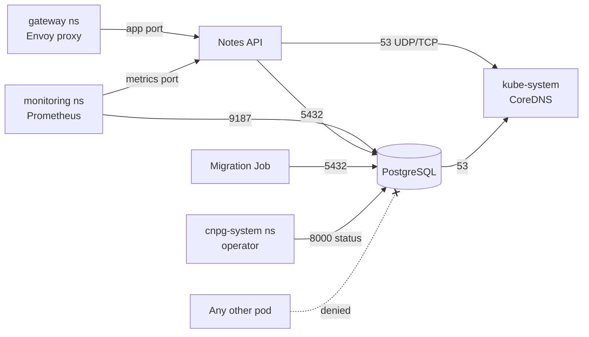
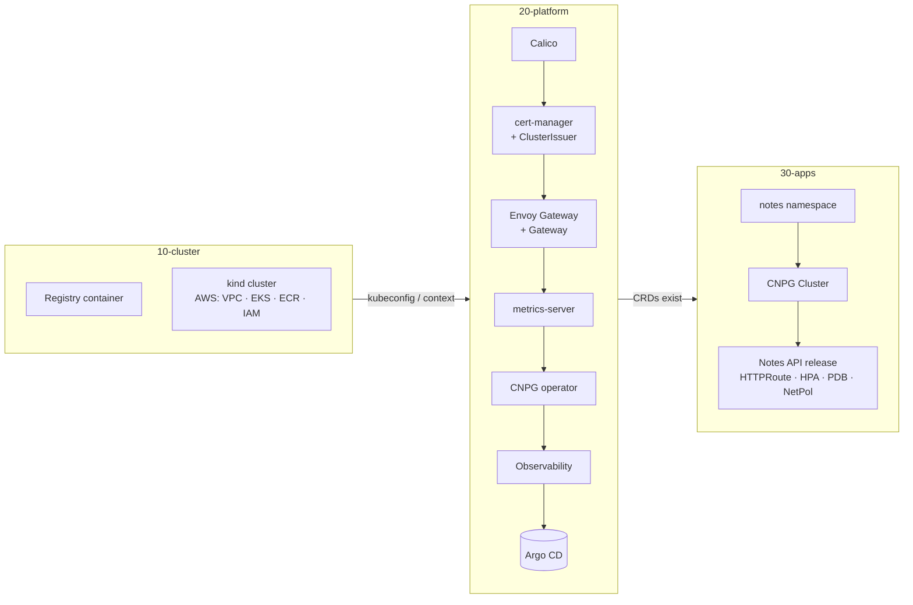
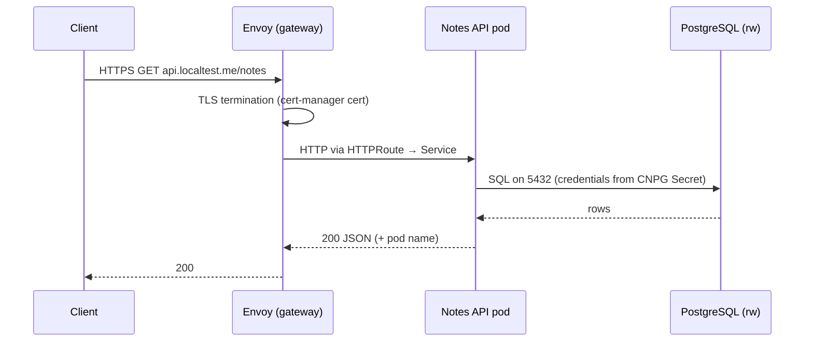
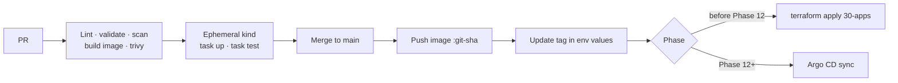
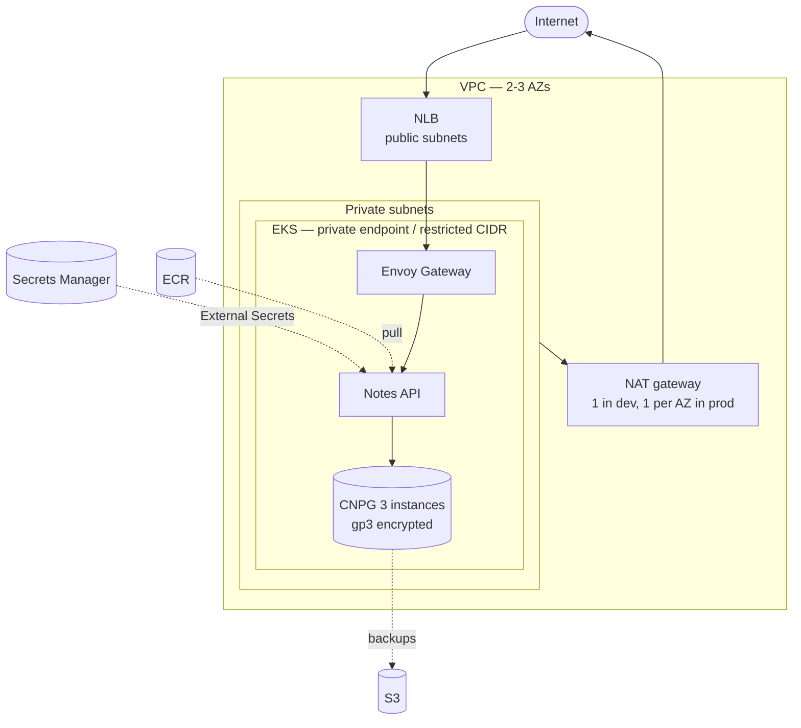

# Architecture

> Local-first, cloud-ready. The same Helm charts and platform layer run on a Terraform-managed `kind` cluster and on AWS EKS; only the cluster layer changes. Decisions are recorded in the [ADRs](adr/README.md).

## 1. System context

Only the gateway accepts traffic from outside the cluster. The database has no external entry point.

## 2. Local topology (kind)

## 3. Network security model

### 3.1 Exposure rules

| Component | Service type | External exposure |
|---|---|---|
| Envoy Gateway proxy | NodePort (local) / LoadBalancer → NLB (AWS) | **Yes** — the only entry point |
| Notes API | ClusterIP | Only via `HTTPRoute` |
| Grafana | ClusterIP | Only via `HTTPRoute` (`grafana.localtest.me`) |
| PostgreSQL | ClusterIP | **Never** — no route, NodePort or LoadBalancer |

### 3.2 NetworkPolicies in `notes`

Default deny for ingress and egress, then explicit allows ([ADR-0005](adr/0005-calico-on-kind.md)):

> Exact ports and pod labels are confirmed against the pinned chart versions when the policies are written (Phase 7) and proven by Phase 9 check #3.

### 3.3 Namespaces and Pod Security Admission

| Namespace | Contents | PSA level |
|---|---|---|
| `notes` | Notes API, migration Job, CNPG `Cluster` | `restricted` |
| `gateway` | Envoy Gateway controller + proxies | `restricted` (verified in Phase 6) |
| `cert-manager` | cert-manager | `restricted` |
| `cnpg-system` | CNPG operator | `restricted` |
| `monitoring` | Prometheus stack, Loki, Alloy | `privileged` — **documented exception**: node-exporter needs hostNetwork/hostPID/hostPath. Alloy tails logs through the API server and needs no host access. |
| `tigera-operator` (+ `calico-system`, managed by the operator) | Calico | `privileged` — **documented exception** (CNI needs host networking) |

All Terraform-created namespaces also set `warn` and `audit` to `restricted`, so any gap stays visible.

### 3.4 Workload hardening (Notes API)

- Non-root UID, `readOnlyRootFilesystem: true`, `allowPrivilegeEscalation: false`, all capabilities dropped, `seccompProfile: RuntimeDefault`.
- Requests and limits on every container.
- Startup, liveness (`/healthz`) and readiness (`/readyz`, checks DB) probes.
- `PodDisruptionBudget` (`minAvailable: 1`) and topology spread across nodes.
- `automountServiceAccountToken: false` unless needed.

## 4. Terraform layout

Three stacks per environment, each with its own state, applied in order and destroyed in reverse ([ADR-0002](adr/0002-three-stack-terraform-layout.md)).

| Stack | Applies | State (local) | State (AWS) |
|---|---|---|---|
| `10-cluster` | Cluster + registry | local file | `s3://<bucket>/<env>/10-cluster/terraform.tfstate` |
| `20-platform` | Controllers + CRDs | local file | `s3://<bucket>/<env>/20-platform/terraform.tfstate` |
| `30-apps` | Namespace, DB, app | local file | `s3://<bucket>/<env>/30-apps/terraform.tfstate` |

Image builds stay out of Terraform: `task build` pushes `localhost:5001/notes-api:<git-sha>` and the tag is passed to `30-apps` as a variable.

## 5. Request and deployment flows

### 5.1 Request path

### 5.2 Delivery path

## 6. Local → AWS mapping

| Concern | Local (kind) | AWS (EKS) |
|---|---|---|
| Cluster | kind + Docker | VPC (2–3 AZs, public/private subnets) + EKS managed node groups |
| CNI / NetworkPolicy | Calico | VPC CNI with network policy enabled |
| Storage | `local-path` PVC | EBS CSI driver + encrypted `gp3` StorageClass |
| Registry | `registry:2` container | ECR (scan on push, immutable tags) |
| Edge | NodePort + `extraPortMappings` | AWS Load Balancer Controller → NLB in front of Envoy |
| TLS | cert-manager self-signed CA | ACM, or cert-manager + Let's Encrypt |
| Secrets | CNPG-generated Secrets | External Secrets Operator + Secrets Manager (Pod Identity) |
| Terraform state | Local files | S3 with native locking, versioning, encryption |
| Database | CNPG, 1 instance | CNPG, 3 instances + S3 backups (RDS as documented alternative) |
| CI credentials | n/a | GitHub OIDC → IAM role |

### 6.1 AWS dev topology

## 7. Related documents

- [User story and epic](user-story.md)
- [ADRs](adr/README.md)
- [SLOs](slo.md)
- [Runbook](runbook.md)
- [GenAI log](genai.md)
- [Project plan](project-plan.md)
