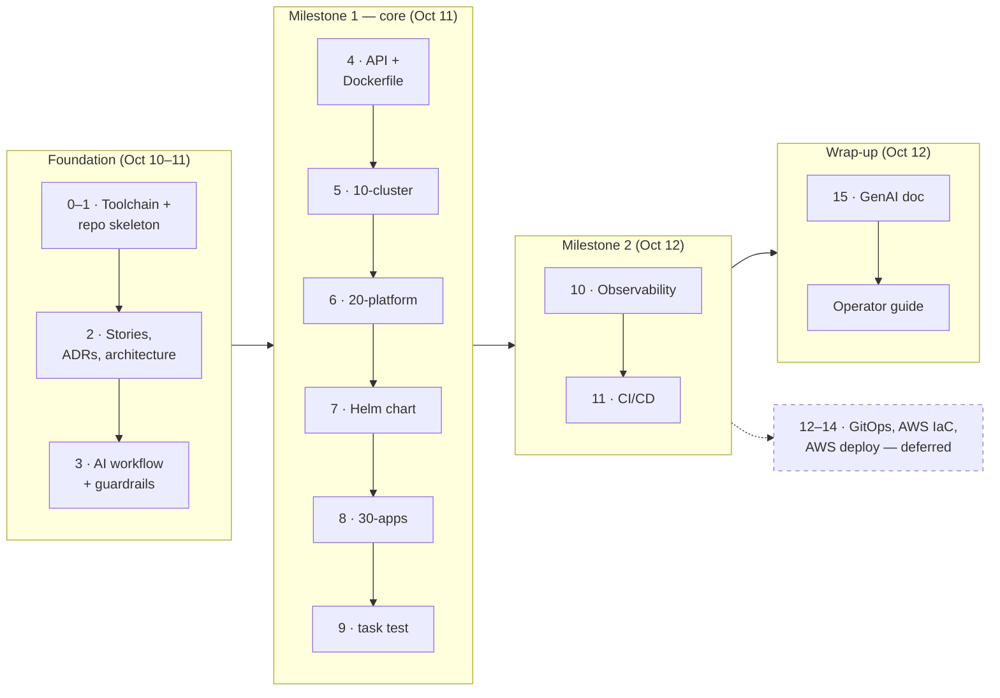
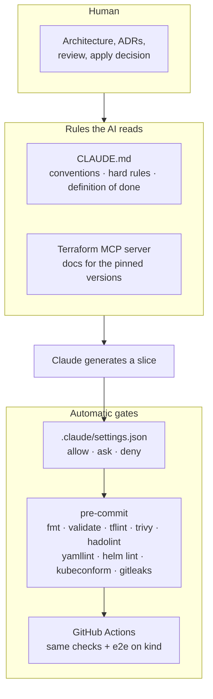
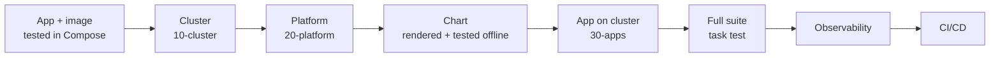
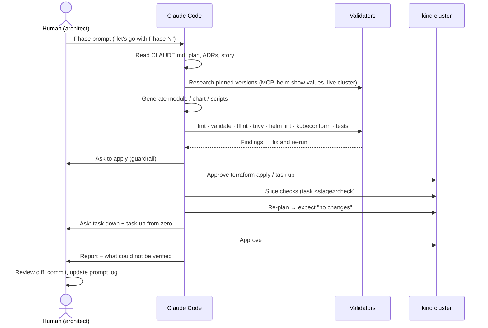
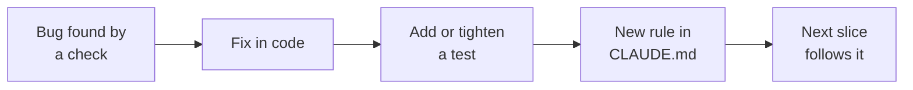

# Development process

> How the solution was built, from a blank repository to a tested platform. This page covers the **method**. The evidence for each AI-assisted step is in [genai.md](genai.md), and the design decisions are in the [ADRs](adr/README.md).

## 1. Summary

The project was built **local-first** and in **thin vertical slices**. Each slice was one phase of the [project plan](project-plan.md), tied to one story in the [user story](user-story.md). It was planned, generated with Claude Code inside fixed guardrails, checked automatically, deployed to `kind`, and committed before the next slice started.

Two choices shaped everything:

1. **Decide before building.** The plan, stories, ADRs and architecture were written first, so every later slice had a written spec to meet.
2. **Prove, don't assume.** A slice was done only when scripted checks passed against a running environment, including a teardown and a rebuild from zero.

## 2. Principles

| Principle | In practice |
|---|---|
| The human is the architect | Architecture, ADRs, security boundaries, diff review and every `apply` stayed with the human. Claude was the pair-programmer. |
| Everything as code | No manual resources. Terraform creates the cluster and platform, Helm deploys the app, and `task` wraps every command. |
| Local-first, cloud-ready | Built and proven on `kind` at zero cost. The modules and charts are designed for reuse on EKS. |
| Thin slices | One phase at a time. Never "the whole infrastructure" at once. |
| Pin everything | Exact versions for Terraform, providers, charts, images and tools. No `latest`. |
| Verify against reality | Versions, labels and metrics were checked against the pinned docs and the live cluster before code was written. |
| Rules grow from mistakes | Each class of bug the process caught became a rule in [`CLAUDE.md`](../CLAUDE.md). |

## 3. Timeline

| Phase | Commit | Delivered | Story |
|---|---|---|---|
| 0–2 | `74d2a55` | Repo skeleton, pre-commit hooks, Taskfile, plan, user story, 9 ADRs, architecture, SLOs, runbook | — |
| 3 | `2a71d38` | `CLAUDE.md`, `.claude/settings.json` guardrails, Terraform MCP server, prompt-log template | S11 |
| 4 | `3e416f8` | FastAPI app, Alembic migrations, hardened image, Compose smoke test | S1 |
| 5 | `cfa54ea` | `kind-cluster` module + `local/10-cluster` (cluster, registry, containerd mirror) | S2 |
| 6 | `9f138df` | `platform-addons` module + `local/20-platform` (8 Helm releases in order) | S3 |
| 7 | `24a1eb1` | `charts/notes-api` with schema, NetworkPolicies, HPA, PDB, migration hook | S4 |
| 8 | `ed00fd8` | `notes-app` module + `local/30-apps` (CNPG database, API release), `task up/down` | S5 |
| 9 | `7da3449` | `task test`: 10 functional checks | S4–S6 |
| 10 | `a6deff7` | Dashboard, alert and SLO rules as code, with promtool tests | S7 |
| 11 | `037c2a6` | GitHub Actions: lint, tests, image scan, kind e2e, image release | S8 |
| 15 | `d897203` | [genai.md](genai.md) finalised with evidence | S11 |
| — | `b546482` | [Operator guide](operator-guide.md) | — |

## 4. Stage 1 — Plan before code (Phases 0–2)

All design documents were written **before any infrastructure code**:

1. **[Project plan](project-plan.md):** 17 ordered phases, each with a goal, steps and a *Done when* condition. It also covers the tech stack, the Terraform design, risks and a milestone checklist.
2. **[User story](user-story.md):** one epic broken into stories S1–S11, each with testable acceptance criteria.
3. **[ADRs](adr/README.md):** nine decisions recorded with alternatives and trade-offs, for example three Terraform stacks, Envoy Gateway over the retired ingress-nginx, and CloudNativePG vs RDS.
4. **[Architecture](architecture.md):** diagrams, the network security model, the namespace/Pod Security table and the local → AWS mapping.
5. **[SLOs](slo.md) and [runbook](runbook.md)** drafts, revised later against the real alert rules.

Writing these first meant short prompts were enough later (§6): the constraints were already in the repository.

## 5. Stage 2 — Guardrails and tooling (Phases 1 and 3)

The safety net was built before anything it would protect:

| Layer | Purpose |
|---|---|
| [`Taskfile.yml`](../Taskfile.yml) | One command per action (`task up`, `task test`). Placeholder targets failed on purpose until their phase landed, so "not implemented" could never look like "passed". |
| [`.pre-commit-config.yaml`](../.pre-commit-config.yaml) | Every validator runs on every commit, whoever wrote the code. |
| [`CLAUDE.md`](../CLAUDE.md) | Architecture, conventions, eight hard rules and the definition of done. Claude reads it in every session. |
| [`.claude/settings.json`](../.claude/settings.json) | **Allowed:** read-only and validation commands. **Ask each time:** `apply`, `destroy`, `helm install`, every `kubectl` write, `task up/down`, `git push`. **Denied:** AWS credentials, kubeconfig, `.env`, Terraform state. |
| [`.mcp.json`](../.mcp.json) | Terraform MCP server, so provider docs come from the registry rather than model memory. |
| Conventional Commits | Enforced by a `commit-msg` hook ([CONTRIBUTING.md](../CONTRIBUTING.md)). |

## 6. Stage 3 — Build in slices (Phases 4–11)

### 6.1 Build order

Bottom-up, so each layer was tested before anything depended on it:

The API was proven with Docker Compose **before** Kubernetes existed, and the chart was proven offline **before** it was deployed. A failure in a later slice could then be blamed on that slice.

### 6.2 The loop for each slice

The phase prompts were deliberately short, for example *"let's go with Phase 8: Stack local/30-apps"*. The plan, ADRs and `CLAUDE.md` supplied the requirements and constraints.

### 6.3 What "done" meant

A slice was closed only when the [definition of done](project-plan.md#9-definition-of-done-global) held:

- Static checks pass (`fmt`, `validate`, `tflint`, `trivy`, `helm lint`, `kubeconform`, `hadolint`, `yamllint`).
- Docs are regenerated (`terraform-docs`, `helm-docs`).
- It is deployed to kind and its scripted checks pass.
- A re-plan shows **no changes** (idempotency).
- There are no secrets, no `latest`, and versions are pinned.
- The story's acceptance criteria are met and the prompt log is updated.

## 7. Verification strategy

Checks were layered from cheapest to most realistic. Each layer caught bugs the earlier ones could not:

| Layer | Tools / scripts | Example of what only this layer caught |
|---|---|---|
| **Research before code** | Terraform MCP, `helm show values`, `kubectl explain`, the live cluster | The kind provider embeds kind v0.31.0, so the node image had to come from that release, not the latest one |
| **Static** | pre-commit hooks, actionlint, promtool | A non-existent `kubeconform --version` flag |
| **Unit / behavioural** | `pytest` (app), 25 chart tests including 11 value sets that must be rejected, promtool rule tests | Every request labelled `handler="unmatched"` in metrics |
| **Live, per stack** | `task cluster:check` · `platform:check` · `apps:check` | Calico v3.33 no longer ships CRDs in its chart (the apply failed) |
| **Live, end to end** | `task test`: 10 checks covering exposure, NetworkPolicy, persistence, HPA, rollout, rollback, drain, idempotency | Envoy ran a single replica with no PDB, so draining its node would cut all traffic |
| **From zero** | `task down` → `cluster:check-clean` → `task up` → `task test` | `task down` hung because Calico was removed before the pods using it |

The full run from zero (`up` → `down` → clean check → `up` → `test`) took about 32 minutes and passed all checks ([P-006](genai.md#p-006--local-validation-suite-task-test-phase-9)).

## 8. Feedback loop: from bug to rule

When verification found a *class* of bug, the fix went into the code **and** into the rules, so the same mistake would not be generated again:

| What went wrong | Rule added to `CLAUDE.md` |
|---|---|
| Model knew Calico's *old* chart layout, not the pinned one | **Versions:** verify against the pinned version's docs; say so when unsure |
| `kubernetes_manifest` for a CR fails before its CRD exists | **Custom resources:** CRs go in a local Helm chart |
| Helm reported the database ready in 1 s; PostgreSQL took 34 s | **Readiness:** add an explicit gate for custom resources |
| New image digest on every build, so every apply caused a rollout | **Images:** reproducible builds, deploy by digest |
| Namespaces destroyed after the CNI, so teardown hung | **Destroy order:** pod-running resources `depends_on` Calico; always test `task down` |
| Drain check passed while draining an empty node | **Tests must not pass vacuously** |
| Error ratio showed "No data" instead of 0 | **Metrics:** query the live Prometheus first; `or vector(0)` on numerators |

The full list of corrections, with diffs, is in [genai.md §5](genai.md#5-corrections-summary).

## 9. Deviations from the plan

Recorded honestly so a reviewer does not have to find them:

| Planned | What happened | Why / status |
|---|---|---|
| Commit raw AI output and human corrections separately | One commit per phase | The verification loop fixed issues before commit. The raw output was recovered from session transcripts for [genai.md](genai.md). The two-commit rule applies again from Phase 16. |
| `checkov` and `trivy` | `trivy config` only | It covers the same Terraform and Kubernetes checks in one tool. |
| Phases 12–14 (Argo CD, AWS IaC, AWS deploy) | Deferred | The core path and no-cost bonuses came first, as the plan's risk table allowed. ADR-0009 stays *Proposed*. |
| PRs blocked by failing CI | Not enforced | Needs branch protection, which conflicts with direct-to-`main` trunk-based work. Open decision. |
| CI e2e on GitHub | Workflow written, first run not verified in the session | A private-repo runner (2 vCPU, 7 GB) may be too small for the full stack. |
| One unexplained failure | 8 of 55 requests failed in one drain run and never reproduced | Mitigated with gateway retries and a longer `preStop`. Recorded as mitigated, not fixed. |

## 10. What comes next

1. **Phase 13:** AWS modules (`network`, `eks`, `ecr`, `iam`) and `dev`/`prod` stacks, validated offline with `tflint`, `trivy` and Infracost. Then give them their own entry in the prompt log.
2. **Phase 12:** Argo CD takes over app delivery from `30-apps` ([ADR-0009](adr/0009-gitops-ownership-split.md)).
3. **Phase 14 (optional):** apply to EKS, run `task test` against the NLB, destroy, and verify no resources are left.
4. **Phase 16:** rehearse from a fresh environment and prepare the presentation.

## 11. Related documents

| Document | Read it for |
|---|---|
| [project-plan.md](project-plan.md) | Every phase in detail |
| [user-story.md](user-story.md) | Acceptance criteria per story |
| [adr/](adr/README.md) | Why each technology was chosen |
| [architecture.md](architecture.md) | What was built |
| [genai.md](genai.md) | Prompts, raw output, corrections and lessons per slice |
| [operator-guide.md](operator-guide.md) | How to run, test and debug it |
