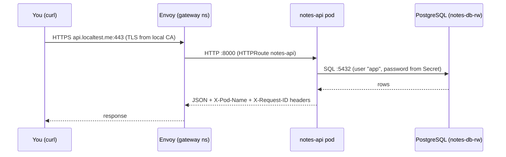
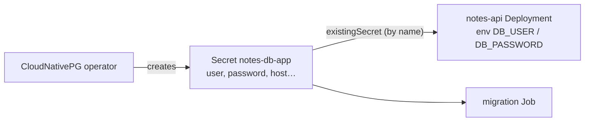
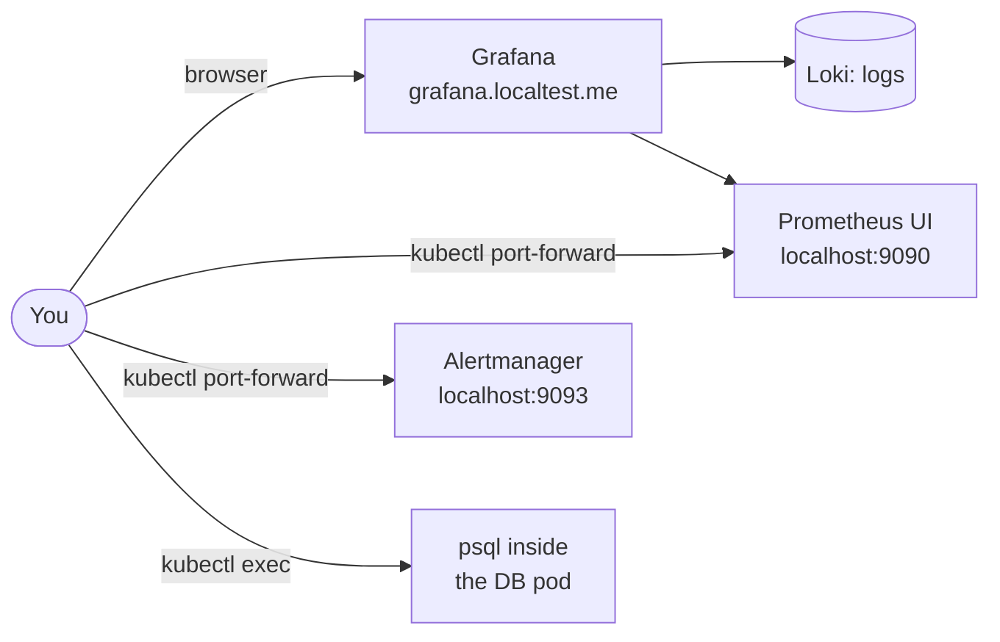
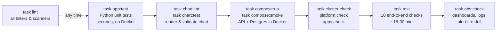
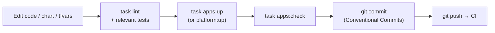
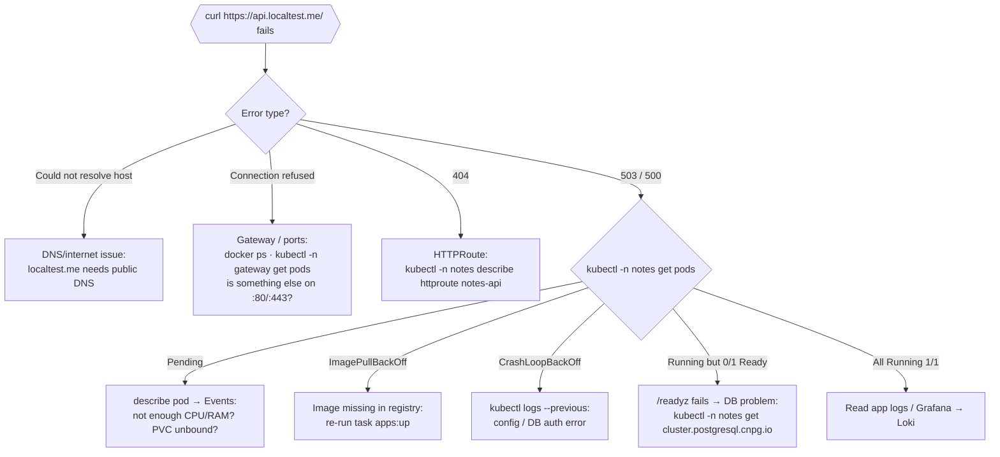
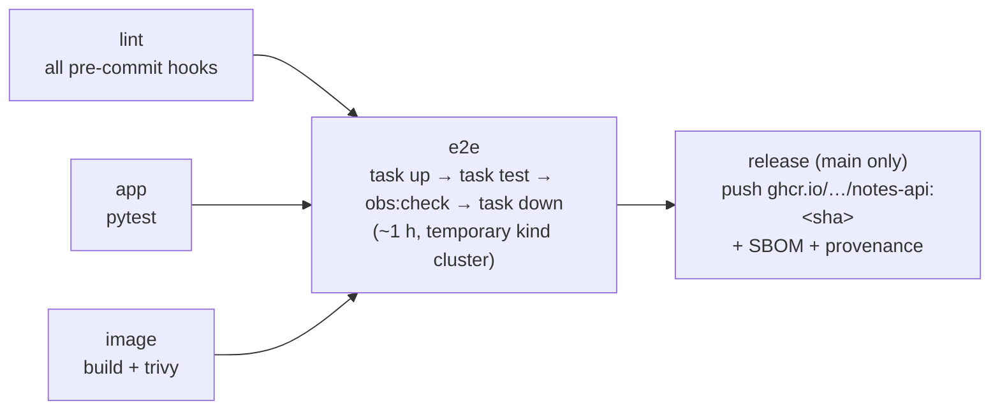

# Operator guide: deploy, use, test and debug the Notes API locally

> A hands-on guide for people who are **not** experts in Kubernetes, Terraform or Helm. It tells you what to run, what you should see, and where to look when something breaks.
>
> - For the *why* behind each choice, see [architecture.md](architecture.md) and the [ADRs](adr/README.md).
> - For alert responses, see the [runbook](runbook.md).
> - For how AI was used to build this, see [genai.md](genai.md).

**Scope:** the local environment (`kind`). The AWS environment, GitOps (Argo CD) and AWS deployment are planned but not built yet ([project-plan.md](project-plan.md), Phases 12–14).

**Contents**

0. [Quick start](#0-quick-start)
1. [What you are deploying](#1-what-you-are-deploying)
2. [The tools in 60 seconds](#2-the-tools-in-60-seconds)
3. [One-time setup](#3-one-time-setup)
4. [Deploy](#4-deploy)
5. [Access and credentials](#5-access-and-credentials) (every URL, user and password)
6. [Use the API](#6-use-the-api)
7. [Consoles and dashboards](#7-consoles-and-dashboards)
8. [Test](#8-test)
9. [Make a change and redeploy](#9-make-a-change-and-redeploy)
10. [Debug](#10-debug)
11. [CI/CD (GitHub Actions)](#11-cicd-github-actions)
12. [Day-to-day: stop, resume, tear down](#12-day-to-day-stop-resume-tear-down)
13. [Where things live](#13-where-things-live)
14. [Safety rules](#14-safety-rules)
15. [Glossary](#15-glossary)

---

## 0. Quick start

If the tools are already installed (§3), five commands go from nothing to a tested environment:

```bash
colima start --cpu 4 --memory 8 --disk 60   # 1. start Docker with enough resources
task setup                                  # 2. install git hooks (once per clone)
task up -- -auto-approve                    # 3. create cluster, platform and app (~15 min)
curl -k https://api.localtest.me/           # 4. the API answers
task test                                   # 5. run the 10 end-to-end checks (~15-30 min)
```

Then open <https://grafana.localtest.me> (user `admin`; for the password see §5). When you are finished, run `task down -- -auto-approve`.

---

## 1. What you are deploying

A small REST API (the Notes API) with several copies (replicas) in front of a PostgreSQL database. Everything runs inside a Kubernetes cluster that lives in Docker containers on your laptop.


- The **gateway** is the only thing reachable from your machine, on ports 80 and 443. Port 80 redirects to HTTPS.
- The **database is never reachable from outside** the cluster. Only the API pods may talk to it, and NetworkPolicies enforce that.
- `*.localtest.me` is a public DNS name that always resolves to `127.0.0.1`, so you don't need to edit `/etc/hosts`. You do need working internet DNS.

### 1.1 What runs where

The cluster has three nodes (Docker containers): `notes-local-control-plane`, `notes-local-worker` and `notes-local-worker2`. Workloads are split into namespaces:

| Namespace | What runs there | Installed by |
|---|---|---|
| `notes` | Notes API (2–4 pods), PostgreSQL (`notes-db-1`), the DB migration Job | `30-apps` |
| `gateway` | Envoy Gateway controller and 2 Envoy proxy pods: the front door | `20-platform` |
| `monitoring` | Prometheus, Alertmanager, Grafana, Loki (logs), Alloy (log/metric collector), node-exporter, kube-state-metrics | `20-platform` |
| `cert-manager` | Issues TLS certificates from a local CA | `20-platform` |
| `cnpg-system` | CloudNativePG operator, which creates and heals the PostgreSQL cluster | `20-platform` |
| `tigera-operator`, `calico-system` | Calico: pod networking and NetworkPolicy enforcement | `20-platform` |
| `kube-system`, `local-path-storage` | Kubernetes itself, metrics-server, the disk provisioner | kind / `20-platform` |

Outside the cluster there is one more container, **`kind-registry`**: a local image registry on `localhost:5001`. The nodes pull the API image from it.

### 1.2 How a request flows



---

## 2. The tools in 60 seconds

| Tool | What it is | What you use it for here |
|---|---|---|
| **Docker** (via Colima) | Runs containers | Hosts the kind cluster nodes and the image registry |
| **kind** | "Kubernetes in Docker" | The local cluster, created by Terraform rather than the `kind` CLI |
| **Kubernetes** | Runs and heals containers ("pods") | Runs the API, the database, the gateway and monitoring |
| **kubectl** | CLI for Kubernetes | Look at pods, logs and events; occasionally change things |
| **Terraform** | Declares infrastructure as code | Creates the cluster, installs add-ons, deploys the app |
| **Helm** | Package manager for Kubernetes ("charts") | Templates the app's Kubernetes objects; Terraform drives it |
| **task** | Command runner (`Taskfile.yml`) | One-word shortcuts: `task up`, `task test`, … Run `task` alone to list them |
| **uv** | Python package and environment manager | Runs the API's unit tests and the chart tests |
| **k6** | Load generator | Proves autoscaling in `task test` |
| **pre-commit** | Git hooks | Lints and scans everything before each commit |

**The golden rule:** you deploy with `task …` (which runs Terraform), and you look with `kubectl …`. Changing things by hand with `kubectl edit/apply/delete` gets overwritten by the next `task …:up`, and breaks check #10 ("no drift").

---

## 3. One-time setup

### 3.1 Install the tools

Install the versions listed in the [README prerequisites](../README.md#prerequisites). On macOS with Homebrew, for example:

```bash
brew install colima docker docker-buildx docker-compose uv terraform helm go-task pre-commit tflint trivy hadolint kubeconform kubectl terraform-docs helm-docs k6 jq actionlint shellcheck
```

> `brew` installs the *latest* versions. If something misbehaves, compare with the pinned versions in the README. `kubectl` must be within one minor version of Kubernetes **1.35**.

Check that everything is there:

```bash
for t in docker terraform helm kubectl task uv k6 jq pre-commit; do printf '%-11s ' "$t"; command -v "$t" >/dev/null && echo ok || echo MISSING; done
```

### 3.2 Give Docker enough resources

The full stack (with monitoring) needs **at least 8 GB RAM and 4 CPUs**:

```bash
colima start --cpu 4 --memory 8 --disk 60
```

Check it with `docker info | grep -E 'CPUs|Total Memory'`. If Colima is already running with less, run `colima stop`, then start it again with the flags above.

### 3.3 Install the git hooks

```bash
task setup
```

From now on every `git commit` runs the linters and scanners, and rejects commit messages that are not [Conventional Commits](../CONTRIBUTING.md#commit-messages--conventional-commits).

### 3.4 Make sure ports are free

Ports **80**, **443** and **5001** on `127.0.0.1` must be free, so no other web server or registry can be running:

```bash
lsof -nP -iTCP:80 -iTCP:443 -iTCP:5001 -sTCP:LISTEN
```

No output means the ports are free.

---

## 4. Deploy

### 4.1 What `task up` does

`task up` applies three Terraform "stacks" in order. Each has its own state file and depends on the previous one.


### 4.2 Run it

```bash
task up
```

Terraform shows a **plan** for each stack and asks `Enter a value:`. Read the plan and type `yes`. To skip the three prompts:

```bash
task up -- -auto-approve
```

> **How to read a plan:** `+` means create, `~` means change in place, `-/+` means replace, and `-` means destroy. The last line summarises it, e.g. `Plan: 5 to add, 0 to change, 0 to destroy.` On a running environment, `No changes.` is the healthy answer.

You can also run each stage on its own, and check it straight afterwards:

| Stage | Deploy | Verify | Typical time |
|---|---|---|---|
| Cluster + registry | `task cluster:up` | `task cluster:check` | ~2 min |
| Platform add-ons | `task platform:up` | `task platform:check` | 5–10 min |
| Database + API | `task apps:up` | `task apps:check` | ~3 min |

> After `cluster:up`, the nodes are `NotReady`. That is expected: they become `Ready` once `platform:up` installs Calico.

### 4.3 Confirm it works

```bash
kubectl config use-context kind-notes-local   # point kubectl at this cluster
kubectl get nodes                              # 3 nodes, all Ready
kubectl -n notes get pods                      # notes-api-… (2) and notes-db-1, all Running
curl -k https://api.localtest.me/              # {"service":"notes-api","message":"Hello from kind","version":"<git sha>","pod":"notes-api-…"}
```

`-k` skips certificate verification, because the certificate comes from a local CA. See §6.2 to verify it properly.

> Every `kubectl` example below assumes `kind-notes-local` is your current context. If you work with several clusters, add `--context kind-notes-local` to every command instead of switching.

---

## 5. Access and credentials

**No password is stored in Git, in Terraform files or in Terraform state.** Each one is generated inside the cluster when it is created, so it is **different after every `task up`**. That is why this guide gives you the command that reads the current password rather than the password itself. Writing a password into a document would be a security bug, and it would be wrong after the next rebuild anyway.

### 5.1 Every system at a glance

| System | How to reach it | User | Password / auth |
|---|---|---|---|
| **Notes API** | <https://api.localtest.me> (Swagger UI: `/docs`) | none | No authentication (demo API) |
| **Grafana** (dashboards, logs, alerts) | <https://grafana.localtest.me> | `admin` | Secret `monitoring/kube-prometheus-stack-grafana`, key `admin-password` |
| **Prometheus** (metrics, targets, rules) | `kubectl -n monitoring port-forward svc/kube-prometheus-stack-prometheus 9090:9090` → <http://localhost:9090> | none | No auth; only reachable through the port-forward |
| **Alertmanager** (active alerts, silences) | `kubectl -n monitoring port-forward svc/kube-prometheus-stack-alertmanager 9093:9093` → <http://localhost:9093> | none | No auth; port-forward only |
| **Loki** (log store) | Through Grafana → Explore → Loki | (Grafana's) | No direct UI |
| **Alloy** (collector debug UI) | `kubectl -n monitoring port-forward svc/alloy 12345:12345` → <http://localhost:12345> | none | No auth; port-forward only |
| **PostgreSQL**, application user | Only from inside the cluster: `kubectl -n notes exec -it notes-db-1 -c postgres -- psql -d app` | `app` | Secret `notes/notes-db-app`, key `password` (generated by CloudNativePG) |
| **PostgreSQL** superuser | Disabled on purpose (`enableSuperuserAccess: false`). `kubectl exec … psql` uses the local socket inside the pod. | `postgres` | No password exists |
| **Compose DB** (§8.2, Docker only) | Not published on the host; only the Compose network | `app` | `DB_PASSWORD` in `app/.env` (gitignored, generated by `task compose:up`) |
| **Local image registry** | <http://localhost:5001/v2/_catalog> | none | No auth; bound to `127.0.0.1` |
| **Kubernetes API** | `kubectl` with context `kind-notes-local` | cluster admin | Client certificate in `~/.kube/config`, written by Terraform |
| **TLS root (local CA)** | Secret `cert-manager/local-ca`, key `ca.crt` | n/a | Trust it to drop `curl -k` (§6.2) |
| **GitHub Container Registry** (CI images) | `ghcr.io/juanpaz90/notes-api:<sha>` | your GitHub user | `docker login ghcr.io` with a GitHub token (repo is private) |

### 5.2 Print all current credentials

Copy and paste this block. It prints to your terminal only, so don't paste the output into chats, tickets or commits.

```bash
k() { kubectl --context kind-notes-local "$@"; }
echo "Grafana     https://grafana.localtest.me"
echo "  user:     $(k -n monitoring get secret kube-prometheus-stack-grafana -o jsonpath='{.data.admin-user}' | base64 -d)"
echo "  password: $(k -n monitoring get secret kube-prometheus-stack-grafana -o jsonpath='{.data.admin-password}' | base64 -d)"
echo "PostgreSQL  (inside the cluster only)"
echo "  host:     $(k -n notes get secret notes-db-app -o jsonpath='{.data.host}' | base64 -d):$(k -n notes get secret notes-db-app -o jsonpath='{.data.port}' | base64 -d)"
echo "  database: $(k -n notes get secret notes-db-app -o jsonpath='{.data.dbname}' | base64 -d)"
echo "  user:     $(k -n notes get secret notes-db-app -o jsonpath='{.data.username}' | base64 -d)"
echo "  password: $(k -n notes get secret notes-db-app -o jsonpath='{.data.password}' | base64 -d)"
```

**Why `base64 -d`?** Kubernetes stores Secret values base64-encoded. That's encoding, not encryption: anyone who can read the Secret can read the password. Access to Secrets is what protects them.

**The `notes-db-app` Secret also contains** `uri` and `jdbc-uri` (complete connection strings), `pgpass` (a ready-made `.pgpass` line), and `fqdn-uri`. List the keys with:

```bash
kubectl -n notes get secret notes-db-app -o json | jq '.data | keys'
```

### 5.3 How the API gets its password (no human involved)



The Helm chart refers to the Secret **by name** and never contains the value. To rotate the password, delete the Secret: the operator regenerates it. Then restart the API so it picks up the new value.

---

## 6. Use the API

### 6.1 Endpoints

| Call | Purpose |
|---|---|
| `GET /` | Message, version (git SHA) and **which pod answered** |
| `GET /healthz` | Is the process alive? (liveness) |
| `GET /readyz` | Can it reach the database? Returns `503` if not (readiness) |
| `GET /notes` · `POST /notes` | List / create notes. Body: `{"title": "…", "content": "…"}`; `title` is 1–200 characters |
| `GET` · `PATCH` · `DELETE /notes/{id}` | Read / update / delete one note |
| `GET /docs` | Interactive Swagger UI. Open <https://api.localtest.me/docs> in a browser and use **Try it out** |
| `GET /metrics` | Prometheus metrics (internal; scraped by Prometheus) |

Every response carries two headers:
- **`X-Pod-Name`**: the pod that answered.
- **`X-Request-ID`**: an ID you can search for in the logs. Send your own `X-Request-ID` and it's reused.

### 6.2 Try it with curl

Save the local CA once, so curl can verify TLS without `-k`:

```bash
kubectl -n cert-manager get secret local-ca -o jsonpath='{.data.ca\.crt}' | base64 -d > /tmp/local-ca.crt
```

Create, list, update and delete a note:

```bash
curl --cacert /tmp/local-ca.crt -X POST https://api.localtest.me/notes -H 'Content-Type: application/json' -d '{"title":"hello","content":"first note"}'
```

```bash
curl --cacert /tmp/local-ca.crt https://api.localtest.me/notes
```

```bash
curl --cacert /tmp/local-ca.crt -X PATCH https://api.localtest.me/notes/1 -H 'Content-Type: application/json' -d '{"content":"edited"}'
```

```bash
curl --cacert /tmp/local-ca.crt -X DELETE -i https://api.localtest.me/notes/1
```

Watch load-balancing across replicas (the `x-pod-name` header changes):

```bash
for i in 1 2 3 4 5 6; do curl -s --cacert /tmp/local-ca.crt -D - -o /dev/null https://api.localtest.me/ | grep -i x-pod-name; done
```

Trace one request end to end:

```bash
curl -s --cacert /tmp/local-ca.crt -H 'X-Request-ID: demo-123' https://api.localtest.me/notes >/dev/null
```

Then search for `demo-123` in Grafana → Explore → Loki (§7.1).

> Your browser will warn about the certificate. You can accept the warning, or trust `/tmp/local-ca.crt` on macOS: open Keychain Access, import the file, open it and set **Always Trust**. This is optional and for local use only. A new CA is generated whenever the cluster is recreated, so remove the old one from Keychain when you destroy the cluster.

---

## 7. Consoles and dashboards



### 7.1 Grafana (metrics, logs, alerts)

Open <https://grafana.localtest.me> and log in as `admin` with the password from §5.2.

**The Notes API dashboard** is at <https://grafana.localtest.me/d/notes-api>, or Dashboards → search "Notes API". Its panels:

| Panel | What to look for |
|---|---|
| SLO stats (availability, p95 latency) | Availability ≥ 99.5%, p95 ≤ 300 ms ([slo.md](slo.md)) |
| Request rate by route and status | Traffic shape; red series are 5xx |
| Error ratio vs SLO budget | 5m and 1h error ratios against the 0.5% budget line |
| Latency percentiles | p50 / p95 / p99 |
| Replicas and HPA | Current vs desired pods; shows scale-out under load |
| API CPU per pod vs request | Why the HPA scaled |
| Database connections | API connections vs the pool limit |
| Restarts, database size vs volume | Crash loops; disk filling up |
| Logs | Recent API log lines |

To see it move, generate traffic in another terminal (a 3-minute k6 test with 20 virtual users):

```bash
k6 run tests/load/notes-api.js
```

Change the load with `VUS=50 DURATION=5m k6 run …`.

**Other useful places:**

- **Dashboards → Kubernetes / Compute Resources / Namespace (Pods)**, namespace `notes`: CPU and memory per pod.
- **Alerting → Alert rules**: the 7 Notes API alerts and their state (Normal / Pending / Firing).
- **Explore → Loki**: logs. Labels available are `namespace`, `pod`, `container` and `app`. Example queries:

  | Goal | LogQL query |
  |---|---|
  | All API logs | `{namespace="notes", app="notes-api"}` |
  | Errors only | `{namespace="notes", app="notes-api"} \| json \| level="error"` |
  | Access log, 5xx only | `{namespace="notes", app="notes-api"} \| json \| logger="notes_api.access" \| status=~"5.."` |
  | Slow requests (> 200 ms) | `{namespace="notes", app="notes-api"} \| json \| duration_ms > 200` |
  | Follow one request | `{namespace="notes"} \|= "<X-Request-ID value>"` |
  | Database logs | `{namespace="notes", pod="notes-db-1"}` |
  | Gateway (Envoy) logs | `{namespace="gateway"}` |

- **Explore → Prometheus**: metrics. Example PromQL:

  | Goal | PromQL query |
  |---|---|
  | Requests per second by status | `sum by (status) (rate(http_requests_total{job="notes-api"}[1m]))` |
  | p95 latency (seconds) | `histogram_quantile(0.95, sum by (le) (rate(http_request_duration_seconds_bucket{job="notes-api"}[5m])))` |
  | Ready API pods | `sum(up{job="notes-api"})` |
  | Error ratio (pre-computed) | `notes_api:slo_errors:ratio_rate5m` |
  | DB connections from the API | `sum(cnpg_backends_total{namespace="notes", application_name="notes-api"})` |

> If a query returns nothing, open **Explore** and use the **Metrics browser** or **Label browser** to see the real names.

### 7.2 Prometheus and Alertmanager UIs (not exposed; use a port-forward)

A **port-forward** opens a temporary tunnel from your laptop to a service inside the cluster. It lasts until you press `Ctrl+C`.

```bash
kubectl -n monitoring port-forward svc/kube-prometheus-stack-prometheus 9090:9090
```

Then open <http://localhost:9090>:
- **Status → Targets**: `notes-api` must be `UP` (one target per API pod).
- **Alerts**: rule state.
- **Status → Rules**: recording rules.

Alertmanager works the same way: `kubectl -n monitoring port-forward svc/kube-prometheus-stack-alertmanager 9093:9093`, then <http://localhost:9093>. There you see firing alerts, and can create a **silence** while you work on something. Locally no receiver is configured (no Slack or e-mail), so alerts are only visible here and in Grafana.

### 7.3 Database console (psql)

The database has no external port, so you open a shell **inside** its pod:

```bash
kubectl -n notes exec -it notes-db-1 -c postgres -- psql -d app
```

Useful commands inside psql:

| Command | Does |
|---|---|
| `\dt` | List tables (`notes`, `alembic_version`) |
| `\d notes` | Show the `notes` table's columns |
| `SELECT * FROM notes ORDER BY id DESC LIMIT 5;` | Newest notes |
| `SELECT version_num FROM alembic_version;` | Applied migration |
| `SELECT application_name, state, count(*) FROM pg_stat_activity GROUP BY 1,2;` | Who is connected |
| `\q` | Quit |

> `kubectl exec` is a write-level command. Avoid changing data by hand; use the API.

Database status, as seen by the operator:

```bash
kubectl -n notes get cluster.postgresql.cnpg.io notes-db      # STATUS should be "Cluster in healthy state"
kubectl -n notes describe cluster.postgresql.cnpg.io notes-db # details and events
```

> Optional: the [`kubectl cnpg` plugin](https://cloudnative-pg.io/documentation/current/kubectl-plugin/) adds `kubectl cnpg status notes-db -n notes`. It is not required by this repo.

### 7.4 Terminal "console" (kubectl cheat sheet)

| Question | Command |
|---|---|
| What is running? | `kubectl -n notes get pods -o wide` |
| Everything in a namespace | `kubectl -n notes get all,httproute,pvc,hpa,pdb,networkpolicy` |
| Everything, everywhere | `kubectl get pods -A` |
| Why is this pod unhappy? | `kubectl -n notes describe pod <pod>` (read **Events** at the bottom) |
| Recent events, newest last | `kubectl -n notes get events --sort-by=.lastTimestamp` |
| API logs (all replicas, live) | `kubectl -n notes logs -l app.kubernetes.io/name=notes-api -f --prefix` |
| Logs of a crashed container | `kubectl -n notes logs <pod> --previous` |
| Migration Job logs | `kubectl -n notes logs job/notes-api-migrate` (the Job is deleted on success) |
| Autoscaler status | `kubectl -n notes get hpa` (`cpu: 8%/70%` = current/target) |
| CPU/memory usage | `kubectl top pods -n notes` · `kubectl top nodes` |
| Database health | `kubectl -n notes get cluster.postgresql.cnpg.io` |
| Gateway and routes | `kubectl -n gateway get gateway,pods` · `kubectl get httproute -A` |
| Certificates | `kubectl get certificate -A` (READY must be `True`) |
| Helm releases | `helm list -A` · `helm -n notes history notes-api` |
| Values a release was installed with | `helm -n notes get values notes-api` |
| What Helm actually applied | `helm -n notes get manifest notes-api \| less` |
| Call the API from inside the cluster | `kubectl -n notes port-forward svc/notes-api 8080:80`, then `curl localhost:8080/readyz` |
| Images in the local registry | `curl -s localhost:5001/v2/_catalog` · `curl -s localhost:5001/v2/notes-api/tags/list` |
| What is this field? | `kubectl explain deployment.spec.strategy` |

> Optional: [k9s](https://k9scli.io/) gives a full-screen terminal UI over the same data (`k9s --context kind-notes-local`). It is not required by this repo.

---

## 8. Test

Tests go from fast and isolated to slow and end-to-end:



| Command | Needs | What it proves |
|---|---|---|
| `task lint` | tools only | Formatting; Terraform, Helm, YAML, Dockerfile and workflow lint; security scans; secret scan |
| `task app:test` · `task app:lint` | `uv` | API logic and database migrations |
| `task scan` | Docker | Dockerfile lint, and no fixable HIGH/CRITICAL CVEs in the image |
| `task chart:lint` · `task chart:test` | `helm`, `uv` | The chart renders and is valid for every environment, and unsafe values are rejected |
| `task obs:test` | Docker | Alert and recording rules are valid, and unit tests prove when they fire |
| `task compose:up` → `task compose:smoke` → `task compose:down` | Docker | API ↔ Postgres work without Kubernetes |
| `task <stage>:check` | running cluster | Each Terraform stack did its job |
| `task test` | running cluster, `k6` | All functional requirements (below) |
| `task obs:check` | running cluster, `k6` | Rules loaded, every dashboard query has data under load, logs searchable, an induced outage fires `NotesApiDown` and resolves |

### 8.1 The end-to-end suite (`task test`)

| # | Check | Changes the cluster? |
|---|---|---|
| 1 | API reachable through the gateway with valid TLS | no |
| 2 | Database not reachable from outside | no |
| 3 | Only the API pods can reach the DB (NetworkPolicy) | temporary probe pods |
| 4 | Data survives deleting the DB pod | deletes the DB pod |
| 5 | 3 replicas all serve traffic | scales the HPA, then restores it |
| 6 | HPA scales out under k6 load and back in | load test |
| 7 | Config change rolls out with zero errors | `terraform apply` |
| 8 | `helm rollback` restores the previous version | rollback + re-apply |
| 9 | Draining a node keeps the API up | drains/uncordons a node |
| 10 | Re-planning every stack shows no changes | no |

Run a subset (check 8 requires check 7):

```bash
CHECKS="1 2 3" task test
```

Each check prints `✔ PASS` / `✘ FAIL` lines with the evidence (status codes, pod names, request counts). If something fails, the message names what was expected; continue with §10.

### 8.2 Test the app without Kubernetes (Docker Compose)

```bash
task compose:up      # PostgreSQL → migrations → API on http://127.0.0.1:8080
task compose:smoke   # 9 checks against it
task compose:down    # stop (keeps data) — or task compose:clean to also delete the DB volume
```

---

## 9. Make a change and redeploy



| You changed… | Run | Notes |
|---|---|---|
| Python code in `app/` | `task app:test`, then `task apps:up` | Builds a new image tagged `<git-sha>` (or `<sha>-dirty` with uncommitted changes) and rolls it out |
| Chart (`charts/notes-api/`) | `task chart:lint && task chart:test`, then `task apps:up` | Then `task chart:docs` if you changed `values.yaml` |
| Just the greeting message | `task apps:up -- -var 'app_message=Hi there'` | A quick way to watch a rolling update. The next plain `task apps:up` puts the default back. |
| Alerts or dashboard (`observability/`) | `task obs:test`, then `task apps:up` | Grafana loads the dashboard within about a minute |
| Platform add-on versions | Edit `infra/environments/local/20-platform/terraform.tfvars`, then `task platform:up` | |
| Terraform module | `terraform fmt -recursive infra && task lint`, then the matching `:up` | |

Watch a rollout live in another terminal:

```bash
kubectl -n notes get pods -w
```

Undo a bad release quickly:

```bash
helm -n notes history notes-api
```

```bash
helm -n notes rollback notes-api <revision>
```

Then run `task apps:up` again so Terraform and the cluster agree.

**Is everything in sync?** A plan should say `No changes.`:

```bash
terraform -chdir=infra/environments/local/20-platform plan
```

`30-apps` needs the deployed image tag and digest as arguments, so use the scripted check, which plans all three stacks the right way:

```bash
CHECKS="10" task test
```

---

## 10. Debug

### 10.1 Where to start



**The general method:** work from the outside in, one layer at a time:

1. Docker
2. Nodes
3. Gateway
4. Route
5. Service
6. Pods
7. Database

At each layer, three commands tell you almost everything: `get` (state), `describe` (events) and `logs` (what the program said).

### 10.2 Common problems

| Symptom | Likely cause | Fix |
|---|---|---|
| `task cluster:up`: `Cannot connect to the Docker daemon` | Colima/Docker not running | `colima start --cpu 4 --memory 8` |
| `cluster:up`: `port is already allocated` (80/443/5001) | Another process uses the port | Stop it (`lsof -nP -iTCP:443 -sTCP:LISTEN`) |
| Nodes `NotReady` | Calico not installed yet | Run `task platform:up` |
| `platform:up` times out, pods `Pending` | Docker has too little RAM/CPU | Give Colima ≥ 8 GB / 4 CPUs, then re-run |
| `apps:up` hangs at `database_ready` | PostgreSQL not starting | `kubectl -n notes describe cluster.postgresql.cnpg.io notes-db` and `kubectl -n cnpg-system logs deploy/cnpg-cloudnative-pg` |
| Release fails: migration Job | Migration error or DB unreachable | `kubectl -n notes get jobs,pods` · `kubectl -n notes logs job/notes-api-migrate` |
| Pods `ImagePullBackOff` | Image not in `localhost:5001` | `curl -s localhost:5001/v2/notes-api/tags/list`, then `task apps:up` |
| API pods `0/1 Ready` | `/readyz` can't reach the DB | Check the DB pod, and the NetworkPolicies: `kubectl -n notes get networkpolicy` |
| `kubectl top` errors | metrics-server still starting | Wait 1–2 min |
| HPA shows `<unknown>` targets | Same as above | Wait; check `kubectl -n kube-system get pods -l app.kubernetes.io/name=metrics-server` |
| Grafana login fails | Password changed with the last `task up` | Re-read it (§5.2) |
| Dashboard shows "No data" | No traffic yet, or Prometheus not scraping | Generate traffic (§7.1); check Prometheus → Status → Targets |
| Browser certificate warning | Local CA is not trusted | Expected; see §6.2 |
| `Error acquiring the state lock` | A previous Terraform run was interrupted | Make sure no other `terraform` is running, then retry |
| `Error: ... connection refused` from Terraform in 20/30 | Cluster gone (e.g. Docker restarted) | `kubectl get nodes`; if broken, `task down && task up` |
| Pods stuck `Terminating` on teardown | Calico removed before pods | Use `task down` (it destroys in the right order); see §12.3 |
| `kubectl`: `context "kind-notes-local" does not exist` | Cluster not created, or kubeconfig reset | `task cluster:up` |

### 10.3 Debugging by layer

**Terraform**

```bash
terraform -chdir=infra/environments/local/20-platform state list           # what Terraform manages
terraform -chdir=infra/environments/local/20-platform state show 'module.platform.helm_release.calico[0]'
TF_LOG=DEBUG task platform:up 2>tf-debug.log                               # very verbose; read the end of tf-debug.log
```

> Never edit `terraform.tfstate` by hand or commit it. It is local, gitignored, and the source of truth for what exists.

**Helm releases**

```bash
helm list -A                              # STATUS should be "deployed"; "failed" or "pending-*" need attention
helm -n notes status notes-api            # last deploy result and notes
helm -n notes history notes-api           # every revision; FAILED ones show why
```

**Gateway and TLS**

```bash
kubectl -n notes describe httproute notes-api        # Conditions: Accepted=True, ResolvedRefs=True
kubectl -n gateway describe gateway platform         # Programmed=True; listener status
kubectl -n gateway logs -l app.kubernetes.io/name=envoy -c envoy --tail=50
kubectl get certificate -A                           # READY=True; if not: kubectl describe certificate -n gateway
curl -vk https://api.localtest.me/ 2>&1 | grep -E 'subject|issuer|HTTP/'
```

**Network policies (is something being blocked?)**

```bash
kubectl -n notes get networkpolicy
kubectl -n notes describe networkpolicy notes-db-ingress
```

The `notes` namespace denies everything by default. Allowed traffic:
- the gateway → API on port 8000
- Prometheus → API (metrics)
- the API and migration Job → database on port 5432
- everyone → DNS
- the CNPG operator → database

The full list is in [architecture.md §3.2](architecture.md). A new connection that is not on that list is blocked by design. Add the allow in the chart or module; never delete the default deny.

**Database**

```bash
kubectl -n notes get cluster.postgresql.cnpg.io,pods,pvc
kubectl -n notes logs notes-db-1 -c postgres --tail=50 | jq -r '.record.message? // .msg? // .'
kubectl -n cnpg-system logs deploy/cnpg-cloudnative-pg --tail=50
```

**Nodes and Docker**

```bash
docker ps --format 'table {{.Names}}\t{{.Status}}'      # notes-local-* and kind-registry must be Up
kubectl describe node notes-local-worker | sed -n '/Conditions/,/Addresses/p'
kubectl get pods -A --field-selector=status.phase!=Running   # anything not running (Completed Jobs are fine)
```

### 10.4 An alert is firing

Every alert links to its section in the [runbook](runbook.md) (the `runbook_url` annotation). Each section follows **meaning → impact → diagnose → mitigate → escalate**. To practise safely, `task obs:check` scales the API to 0 for about two minutes, watches `NotesApiDown` fire, and restores it.

### 10.5 Debugging the app without Kubernetes

A faster loop for Python bugs:

```bash
cd app && uv run pytest -x -k <test-name>      # one test, stop on first failure
task compose:up                                 # API on http://127.0.0.1:8080
docker compose -f app/compose.yaml logs -f api  # follow API logs
task compose:down
```

---

## 11. CI/CD (GitHub Actions)

Every push to `main` and every pull request runs [`.github/workflows/ci.yml`](../.github/workflows/ci.yml). Changes that only touch docs (`*.md`, `docs/`) are skipped.



| Where | What you see |
|---|---|
| GitHub → **Actions** tab → the run | Each job's log; a red ✘ marks the failing step |
| A failed `e2e` run → **Artifacts** | `e2e-diagnostics`: nodes, pods, events, Helm releases, API logs |
| A `release` run → **Summary** | The published image, tag and digest |

- **Re-run** a failed job: open the run and click **Re-run failed jobs**. Or start one by hand: Actions → CI → **Run workflow**.
- **Reproduce locally** before pushing:
  - `lint`: `task lint`
  - `app`: `task app:test`
  - `image`: `task scan`
  - `e2e`: `task up -- -auto-approve && task test && task obs:check`
- **Cost:** the repository is private, so runs use the account's free Actions minutes (2,000/month). One run is about one hour. Run the checks locally first.
- **Pull the released image:**

  ```bash
  echo <GitHub token with read:packages> | docker login ghcr.io -u <your GitHub user> --password-stdin
  docker pull ghcr.io/juanpaz90/notes-api:<short sha>
  ```

---

## 12. Day-to-day: stop, resume, tear down

### 12.1 Pause without losing anything

```bash
colima stop     # stops Docker and with it the cluster; notes and state are kept
colima start    # later: the kind containers start again by themselves
```

After a restart, give the cluster 2–3 minutes. Then check with `kubectl get nodes` and `curl -k https://api.localtest.me/`. If it does not recover, use §12.2 and run `task up` again.

### 12.2 Normal teardown

```bash
task down
```

`task down` works in reverse order: apps → platform → cluster. Add `-- -auto-approve` to skip the prompts. Check nothing is left:

```bash
task cluster:check-clean
```

> **This deletes all notes,** because the database disk lives inside the kind nodes. It also creates new passwords and a new CA on the next `task up`.

Partial resets are fine too. For example, `task apps:down && task apps:up` redeploys only the app with a fresh database.

### 12.3 When teardown is stuck (last resort)

Follow the [runbook](runbook.md#recover-from-a-broken-local-environment). If `terraform destroy` fails on `10-cluster`, delete the containers by hand and remove the local state files of all three stacks:

```bash
docker rm -f notes-local-control-plane notes-local-worker notes-local-worker2 kind-registry
```

```bash
rm -f infra/environments/local/{10-cluster,20-platform,30-apps}/terraform.tfstate*
```

```bash
kubectl config delete-context kind-notes-local
```

Then `task up` starts from zero.

---

## 13. Where things live

| Path | Contents |
|---|---|
| `app/` | API source, tests, Dockerfile, Compose file |
| `charts/notes-api/` | Helm chart; `values-local.yaml` is what kind uses; `README.md` lists every value |
| `infra/modules/` | Reusable Terraform modules (`kind-cluster`, `platform-addons`, `notes-app`), each with a generated README |
| `infra/environments/local/<stack>/` | Wiring + `terraform.tfvars` for each stack (versions, sizes, names) |
| `observability/` | Alert/recording rules, their tests, the Grafana dashboard |
| `tests/infra/`, `tests/e2e/`, `tests/load/`, `tests/observability/`, `tests/chart/` | Stack checks, end-to-end suite, k6 script, observability checks, chart tests |
| `.github/` | CI workflow, shared toolchain action, Dependabot |
| `Taskfile.yml` | Every `task` command (`task` alone lists them) |
| `docs/` | This guide, [architecture](architecture.md), [ADRs](adr/README.md), [runbook](runbook.md), [SLOs](slo.md), [user stories](user-story.md), [plan](project-plan.md), [GenAI log](genai.md) |
| `CLAUDE.md`, `.claude/settings.json` | Rules and guardrails for the AI assistant |

**Further reading, in order:** README → this guide → [architecture.md](architecture.md) → the [ADRs](adr/README.md) (why each tool was chosen) → [runbook.md](runbook.md).

## 14. Safety rules

- **Never commit secrets.** Passwords come from the cluster (CNPG and Grafana Secrets), not from files. The pre-commit hooks (gitleaks) block most accidents. Never paste the output of §5.2 anywhere.
- **Never expose the database:** no NodePort, LoadBalancer or HTTPRoute to it.
- **Change things through Terraform and Helm (`task …`)**, not by hand with `kubectl edit/apply`. Manual changes are overwritten, and they break check #10.
- **Read every plan before typing `yes`,** especially lines with `destroy` or `-/+` (replace).
- **Never delete or commit `terraform.tfstate`** unless you are following §12.3.

## 15. Glossary

| Word | Meaning |
|---|---|
| **Pod** | One running instance of a container (e.g. one API copy) |
| **Deployment** | Keeps N identical pods running and rolls out new versions |
| **ReplicaSet** | The set of pods for one version of a Deployment (the hash in pod names) |
| **Service** | Stable internal address in front of pods (`ClusterIP` = internal only) |
| **Namespace** | A folder for resources: `notes`, `gateway`, `monitoring`, … |
| **Secret / ConfigMap** | Key/value configuration; Secrets hold sensitive values (base64, not encrypted) |
| **HPA** | HorizontalPodAutoscaler: adds or removes API pods based on CPU |
| **PDB** | PodDisruptionBudget: "keep at least 1 pod" during drains and upgrades |
| **PVC / PV** | PersistentVolumeClaim / Volume: the database's disk |
| **Probe** | Kubernetes calls `/healthz` (restart if failing) and `/readyz` (stop sending traffic if failing) |
| **Gateway / HTTPRoute** | Gateway API: the entry point, and the rule "`api.localtest.me` → notes-api Service" |
| **NetworkPolicy** | A firewall between pods (default in `notes`: deny everything) |
| **CRD / CR** | Custom Resource Definition: a new object type (e.g. `Cluster` from CNPG) and its instances |
| **Operator** | A controller that manages a complex app for you (CNPG manages PostgreSQL) |
| **CNPG Cluster** | The PostgreSQL database, managed by the CloudNativePG operator |
| **CNI** | Container Network Interface: the pod-network plugin (Calico here) |
| **Helm chart / release** | A templated package / one installed copy of it, with numbered revisions |
| **Terraform stack / state** | A folder applied together / the file recording what Terraform created |
| **Plan / apply / destroy** | Preview changes / make them / remove everything the stack created |
| **Drift** | The cluster differs from the code; a plan shows changes nobody intended |
| **Drain / cordon** | Evict pods from a node / stop scheduling new pods on it (node maintenance) |
| **SLO / error budget** | A reliability target (99.5% available) / how much failure that allows (0.5%) |
| **Burn rate** | How fast the error budget is being used up; alerts fire on fast burns |
| **Digest** | `sha256:…` content hash of an image; unlike a tag, it can never point to different content |
