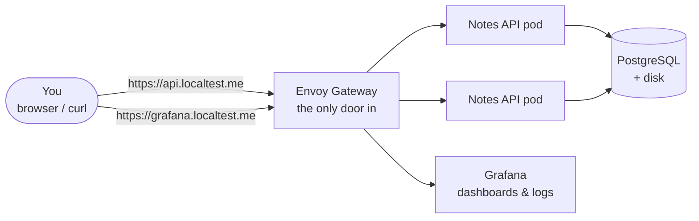
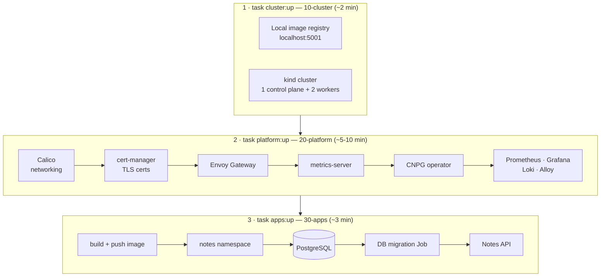
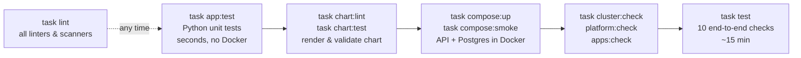
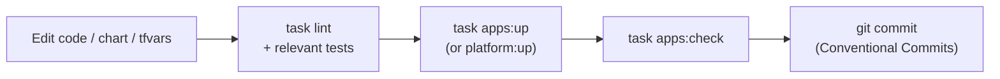
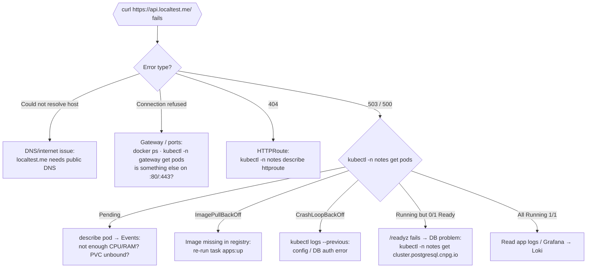

# Operator guide — deploy, use, test and debug the Notes API locally

> A hands-on guide for people who are **not** experts in Kubernetes, Terraform or Helm. It tells you what to run, what you should see, and where to look when something breaks. For the *why* behind each choice, see [architecture.md](architecture.md) and the [ADRs](adr/README.md). For alert responses, see the [runbook](runbook.md).

**Scope:** the local environment (`kind`). The AWS environment is not implemented yet ([project-plan.md](project-plan.md)).

---

## 1. What you are deploying

A small REST API (Notes API) with several copies (replicas) in front of a PostgreSQL database. Everything runs inside a Kubernetes cluster that lives in Docker containers on your laptop.



- The **gateway** is the only thing reachable from your machine (ports 80/443).
- The **database is never reachable from outside** the cluster. Only the API pods may talk to it.
- `*.localtest.me` is a public DNS name that always resolves to `127.0.0.1`, so no `/etc/hosts` edits are needed (you need working DNS/internet).

---

## 2. The tools in 60 seconds

| Tool | What it is | What you use it for here |
|---|---|---|
| **Docker** (via Colima) | Runs containers | Hosts the kind cluster nodes and the image registry |
| **kind** | "Kubernetes in Docker" | The local cluster (created by Terraform, not by the `kind` CLI) |
| **Kubernetes** | Runs and heals containers ("pods") | Runs the API, DB, gateway, monitoring |
| **kubectl** | CLI for Kubernetes | Look at pods, logs, events; occasionally change things |
| **Terraform** | Declares infrastructure as code | Creates the cluster, installs add-ons, deploys the app |
| **Helm** | Package manager for Kubernetes ("charts") | Templates the app's Kubernetes objects; Terraform drives it |
| **task** | Command runner (`Taskfile.yml`) | One-word shortcuts: `task up`, `task test`, … |
| **uv** | Python package/env manager | Runs the API's unit tests |
| **k6** | Load generator | Proves autoscaling in `task test` |
| **pre-commit** | Git hooks | Lints everything before each commit |

Key Kubernetes words:

| Word | Meaning |
|---|---|
| **Pod** | One running instance of a container (e.g. one API copy) |
| **Deployment** | Keeps N identical pods running and rolls out new versions |
| **Service** | Stable internal address in front of pods (`ClusterIP` = internal only) |
| **Namespace** | A folder for resources: `notes`, `gateway`, `monitoring`, … |
| **HPA** | HorizontalPodAutoscaler — adds/removes API pods based on CPU |
| **PVC** | PersistentVolumeClaim — the database's disk |
| **HTTPRoute** | Gateway rule: "requests for `api.localtest.me` go to the notes-api Service" |
| **NetworkPolicy** | Firewall between pods (default: deny everything in `notes`) |
| **CNPG Cluster** | The PostgreSQL database, managed by the CloudNativePG operator |

---

## 3. One-time setup

### 3.1 Install the tools

Install the versions listed in the [README prerequisites](../README.md#prerequisites). On macOS with Homebrew, for example:

```bash
brew install colima docker docker-buildx docker-compose uv terraform helm go-task pre-commit tflint trivy hadolint kubeconform kubectl terraform-docs k6 jq
```

> `brew` installs the *latest* versions. If something misbehaves, compare with the pinned versions in the README. `kubectl` must be within one minor version of Kubernetes **1.35**.

### 3.2 Give Docker enough resources

The full stack (with monitoring) needs **≥ 8 GB RAM and ≥ 4 CPUs**:

```bash
colima start --cpu 4 --memory 8 --disk 60
```

Check it: `docker info | grep -E 'CPUs|Total Memory'`.

### 3.3 Install the git hooks

```bash
task setup
```

### 3.4 Make sure ports are free

Ports **80**, **443** and **5001** on `127.0.0.1` must be free (no other web server or registry running):

```bash
lsof -nP -iTCP:80 -iTCP:443 -iTCP:5001 -sTCP:LISTEN
```

---

## 4. Deploy

### 4.1 What `task up` does

Three Terraform "stacks", applied in order. Each has its own state file and depends on the previous one.



### 4.2 Run it

```bash
task up
```

Terraform shows a **plan** for each stack and asks `Enter a value:`. Read the plan, type `yes`. To skip the three prompts:

```bash
task up -- -auto-approve
```

You can also run each stage on its own, and check it right after:

| Stage | Deploy | Verify |
|---|---|---|
| Cluster + registry | `task cluster:up` | `task cluster:check` |
| Platform add-ons | `task platform:up` | `task platform:check` |
| Database + API | `task apps:up` | `task apps:check` |

> After `cluster:up`, the nodes are `NotReady` — that is expected. They become `Ready` once Calico is installed by `platform:up`.

### 4.3 Confirm it works

```bash
kubectl config use-context kind-notes-local   # point kubectl at this cluster
kubectl get nodes                              # 3 nodes, all Ready
kubectl -n notes get pods                      # notes-api-… (2) and notes-db-1, all Running
curl -k https://api.localtest.me/              # {"service":"notes-api","message":"Hello from kind",...}
```

`-k` skips certificate verification because the certificate comes from a local CA. See §5.2 to verify it properly.

---

## 5. Use the API

### 5.1 Endpoints

| Call | Purpose |
|---|---|
| `GET /` | Message, version and **which pod answered** |
| `GET /healthz` | Is the process alive? |
| `GET /readyz` | Can it reach the database? (`503` if not) |
| `GET /notes` · `POST /notes` | List / create notes |
| `GET` · `PATCH` · `DELETE /notes/{id}` | Read / update / delete one note |
| `GET /docs` | Interactive Swagger UI — open <https://api.localtest.me/docs> in a browser |
| `GET /metrics` | Prometheus metrics |

### 5.2 Try it with curl

Save the local CA once so curl can verify TLS without `-k`:

```bash
kubectl -n cert-manager get secret local-ca -o jsonpath='{.data.ca\.crt}' | base64 -d > /tmp/local-ca.crt
```

```bash
curl --cacert /tmp/local-ca.crt -X POST https://api.localtest.me/notes -H 'Content-Type: application/json' -d '{"title":"hello","content":"first note"}'
```

```bash
curl --cacert /tmp/local-ca.crt https://api.localtest.me/notes
```

See load-balancing across replicas (the `x-pod-name` header changes):

```bash
for i in 1 2 3 4 5 6; do curl -s --cacert /tmp/local-ca.crt -D - -o /dev/null https://api.localtest.me/ | grep -i x-pod-name; done
```

> The browser will warn about the certificate. Accept it, or add `/tmp/local-ca.crt` to the macOS Keychain as trusted (optional, local only — remove it when you destroy the cluster).

---

## 6. Consoles and dashboards


### 6.1 Grafana (metrics + logs)

URL: <https://grafana.localtest.me> — user `admin`. The password is generated in the cluster:

```bash
kubectl -n monitoring get secret kube-prometheus-stack-grafana -o jsonpath='{.data.admin-password}' | base64 -d; echo
```

Useful places:

- **Dashboards → Browse → Kubernetes / Compute Resources / Namespace (Pods)**, namespace `notes` — CPU and memory per pod.
- **Explore → Loki** — logs. Example queries:

  | Goal | LogQL query |
  |---|---|
  | All API logs | `{namespace="notes", app="notes-api"}` |
  | Errors only | `{namespace="notes", app="notes-api"} \| json \| level="error"` |
  | Slow requests (> 200 ms) | `{namespace="notes", app="notes-api"} \| json \| duration_ms > 200` |
  | Follow one request | `{namespace="notes"} \|= "<x-request-id value>"` |

- **Explore → Prometheus** — metrics. Example PromQL:

  | Goal | PromQL query |
  |---|---|
  | Requests per second by status | `sum by (status) (rate(http_requests_total{namespace="notes"}[1m]))` |
  | p95 latency | `histogram_quantile(0.95, sum by (le) (rate(http_request_duration_seconds_bucket{namespace="notes"}[5m])))` |
  | API pods count | `count(up{namespace="notes", job=~".*notes-api.*"})` |

> If a label returns nothing, open **Explore** and use the label browser to see the real label names.

### 6.2 Prometheus and Alertmanager UIs (not exposed; use port-forward)

```bash
kubectl -n monitoring port-forward svc/kube-prometheus-stack-prometheus 9090:9090
```

Then open <http://localhost:9090> → **Status → Targets** to check that `notes-api` is being scraped. Stop with `Ctrl+C`. Alertmanager works the same way with `svc/kube-prometheus-stack-alertmanager 9093:9093`.

### 6.3 Database console (psql)

The DB has no external port, so you open a shell **inside** its pod:

```bash
kubectl -n notes exec -it notes-db-1 -c postgres -- psql -d app
```

Inside psql: `\dt` (tables), `SELECT * FROM notes LIMIT 5;`, `\q` (quit).

> `kubectl exec` is a write-level command. Avoid changing data by hand; use the API.

### 6.4 Terminal "console" (kubectl cheat sheet)

| Question | Command |
|---|---|
| What is running? | `kubectl -n notes get pods -o wide` |
| Everything in a namespace | `kubectl -n notes get all,httproute,pvc,hpa,pdb,networkpolicy` |
| Why is this pod unhappy? | `kubectl -n notes describe pod <pod>` (read **Events** at the bottom) |
| Recent events, newest last | `kubectl -n notes get events --sort-by=.lastTimestamp` |
| API logs (all replicas, live) | `kubectl -n notes logs -l app.kubernetes.io/name=notes-api -f --prefix` |
| Logs of a crashed container | `kubectl -n notes logs <pod> --previous` |
| Migration Job logs | `kubectl -n notes logs job/notes-api-migrate` (deleted on success) |
| Autoscaler status | `kubectl -n notes get hpa` |
| CPU/memory usage | `kubectl top pods -n notes` · `kubectl top nodes` |
| Database health | `kubectl -n notes get cluster.postgresql.cnpg.io` |
| Gateway and routes | `kubectl -n gateway get gateway,pods` · `kubectl -n notes get httproute` |
| Certificates | `kubectl get certificate -A` |
| Helm releases | `helm list -A` · `helm -n notes history notes-api` |
| Call the API from inside the cluster | `kubectl -n notes port-forward svc/notes-api 8080:80` then `curl localhost:8080/readyz` |

> Optional: [k9s](https://k9scli.io/) gives a full-screen terminal UI over the same data (`k9s --context kind-notes-local`). It is not required by this repo.

---

## 7. Test

Tests go from fast and isolated to slow and end-to-end:



| Command | Needs | What it proves |
|---|---|---|
| `task lint` | tools only | Formatting, Terraform/Helm/YAML/Dockerfile lint, secret scan |
| `task app:test` · `task app:lint` | `uv` | API logic and migrations |
| `task scan` | Docker | Dockerfile lint + no fixable HIGH/CRITICAL CVEs in the image |
| `task chart:lint` · `task chart:test` | `helm`, `uv` | Chart renders and is valid for every environment |
| `task compose:up` → `task compose:smoke` → `task compose:down` | Docker | API ↔ Postgres work without Kubernetes |
| `task <stage>:check` | running cluster | Each Terraform stack did its job |
| `task test` | running cluster, `k6` | All functional requirements (below) |

### 7.1 The end-to-end suite (`task test`)

| # | Check | Changes the cluster? |
|---|---|---|
| 1 | API reachable through the gateway with valid TLS | no |
| 2 | Database not reachable from outside | no |
| 3 | Only the API pods can reach the DB (NetworkPolicy) | temporary probe pods |
| 4 | Data survives deleting the DB pod | deletes DB pod |
| 5 | 3 replicas all serve traffic | scales HPA, restores |
| 6 | HPA scales out under k6 load and back in | load test |
| 7 | Config change rolls out with zero errors | `terraform apply` |
| 8 | `helm rollback` restores the previous version | rollback + re-apply |
| 9 | Draining a node keeps the API up | drains/uncordons a node |
| 10 | Re-planning every stack shows no changes | no |

Run a subset (note: check 8 requires 7):

```bash
CHECKS="1 2 3" task test
```

---

## 8. Make a change and redeploy



| You changed… | Run | Notes |
|---|---|---|
| Python code in `app/` | `task app:test` then `task apps:up` | Builds a new image tagged `<git-sha>` (or `<sha>-dirty` with uncommitted changes) and rolls it out |
| Chart (`charts/notes-api/`) | `task chart:lint && task chart:test` then `task apps:up` | Then `task chart:docs` if you changed `values.yaml` |
| Just the greeting message | `task apps:up -- -var 'app_message=Hi there'` | Quick way to watch a rolling update |
| Platform add-on versions | edit `infra/environments/local/20-platform/terraform.tfvars`, `task platform:up` | |
| Terraform module | `terraform fmt -recursive infra && task lint`, then the matching `:up` | |

Watch a rollout live in another terminal:

```bash
kubectl -n notes get pods -w
```

Undo a bad release quickly:

```bash
helm -n notes history notes-api
```

```bash
helm -n notes rollback notes-api <revision>
```

Then run `task apps:up` again so Terraform and the cluster agree.

---

## 9. Debug

### 9.1 Where to start



### 9.2 Common problems

| Symptom | Likely cause | Fix |
|---|---|---|
| `task cluster:up`: `Cannot connect to the Docker daemon` | Colima/Docker not running | `colima start --cpu 4 --memory 8` |
| `cluster:up`: `port is already allocated` (80/443/5001) | Another process uses the port | Stop it (`lsof -nP -iTCP:443 -sTCP:LISTEN`) |
| Nodes `NotReady` | Calico not installed yet | Run `task platform:up` |
| `platform:up` times out, pods `Pending` | Docker has too little RAM/CPU | Give Colima ≥ 8 GB / 4 CPUs, then re-run |
| `apps:up` hangs at `database_ready` | PostgreSQL not starting | `kubectl -n notes describe cluster.postgresql.cnpg.io notes-db` and `kubectl -n cnpg-system logs deploy/cnpg-cloudnative-pg` |
| Release fails: migration Job | Migration error or DB unreachable | `kubectl -n notes get jobs,pods` · `kubectl -n notes logs job/notes-api-migrate` |
| Pods `ImagePullBackOff` | Image not in `localhost:5001` | `curl -s localhost:5001/v2/notes-api/tags/list`, then `task apps:up` |
| API pods `0/1 Ready` | `/readyz` can't reach DB | Check DB pod, and NetworkPolicies: `kubectl -n notes get networkpolicy` |
| `kubectl top` errors | metrics-server still starting | Wait 1–2 min |
| HPA shows `<unknown>` targets | Same as above | Wait; check `kubectl -n kube-system get pods -l app.kubernetes.io/name=metrics-server` |
| Browser certificate warning | Local CA is not trusted | Expected; see §5.2 |
| `Error acquiring the state lock` | A previous Terraform run was interrupted | Make sure no other `terraform` is running, then retry |
| Pods stuck `Terminating` on teardown | Calico removed before pods | Use `task down` (it destroys in the right order); see §10.2 |
| `kubectl`: `context "kind-notes-local" does not exist` | Cluster not created, or kubeconfig reset | `task cluster:up` |

### 9.3 Debugging the app without Kubernetes

Faster loop for Python bugs:

```bash
cd app && uv run pytest -x -k <test-name>      # one test, stop on first failure
task compose:up                                 # API on http://127.0.0.1:8080
docker compose -f app/compose.yaml logs -f api  # follow API logs
task compose:down
```

---

## 10. Tear down

### 10.1 Normal teardown

```bash
task down
```

Reverse order: apps → platform → cluster. Add `-- -auto-approve` to skip prompts. Verify nothing is left:

```bash
task cluster:check-clean
```

> **This deletes all notes.** The DB disk lives inside the kind nodes.

Partial resets are fine too, e.g. `task apps:down && task apps:up` to redeploy only the app and a fresh database.

### 10.2 When teardown is stuck (last resort)

Follow the [runbook](runbook.md#recover-from-a-broken-local-environment): if `terraform destroy` fails on `10-cluster`, delete the containers by hand and remove the local state files of all three stacks:

```bash
docker rm -f notes-local-control-plane notes-local-worker notes-local-worker2 kind-registry
```

```bash
rm -f infra/environments/local/{10-cluster,20-platform,30-apps}/terraform.tfstate*
```

```bash
kubectl config delete-context kind-notes-local
```

Then `task up` starts from zero.

---

## 11. Where things live

| Path | Contents |
|---|---|
| `app/` | API source, tests, Dockerfile, Compose file |
| `charts/notes-api/` | Helm chart; `values-local.yaml` is what kind uses |
| `infra/modules/` | Reusable Terraform modules (`kind-cluster`, `platform-addons`, `notes-app`) |
| `infra/environments/local/<stack>/` | Wiring + `terraform.tfvars` for each stack |
| `tests/infra/`, `tests/e2e/`, `tests/load/` | Stack checks, end-to-end suite, k6 script |
| `Taskfile.yml` | All `task` commands (`task` alone lists them) |

## 12. Safety reminders

- Never commit secrets. Passwords come from the cluster (CNPG, Grafana Secrets), not from files.
- Never expose the database (no NodePort, LoadBalancer or HTTPRoute to it).
- Change things through Terraform/Helm (`task …`), not by hand with `kubectl edit/apply` — manual changes are overwritten and break check #10.
